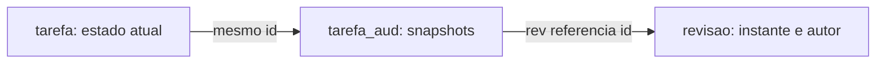

# 02 — Mapeamento e tabelas

**Prioridade:** essencial. **Pergunta:** como a tarefa se transforma em dados auditados?

## O mapa da nossa aplicação



O desenho representa vínculos lógicos. `tarefa_aud.id` não tem chave estrangeira para `tarefa.id`: o histórico precisa continuar existindo depois que a tarefa atual for removida. Já `tarefa_aud.rev` referencia `revisao.id` na migração atual.

| Elemento | Significado no projeto |
|---|---|
| `@Audited(withModifiedFlag = true)` | `Tarefa` tem campos auditados e flags de modificação |
| `tarefa_aud.id` + `rev` | Identificam um snapshot da tarefa naquela revisão |
| `revtype` | Operação: 0 criação, 1 alteração, 2 exclusão |
| `titulo_mod`, `concluida_mod` | Indicadores usados para identificar mudanças |
| `revisao` | Entidade personalizada de metadados; substitui a tabela padrão `REVINFO` |

Veja a [entidade Tarefa](../../src/main/java/br/com/laboratorio/todo/tarefa/Tarefa.java), a [entidade Revisao](../../src/main/java/br/com/laboratorio/todo/audit/Revisao.java) e a [migração V1](../../src/main/resources/db/migration/V1__tarefas_e_auditoria.sql).

## Configuração que já existe

Em [application.properties](../../src/main/resources/application.properties):

```properties
spring.jpa.hibernate.ddl-auto=validate
spring.jpa.properties.org.hibernate.envers.audit_table_suffix=_aud
spring.jpa.properties.org.hibernate.envers.modified_flag_suffix=_mod
spring.jpa.properties.org.hibernate.envers.store_data_at_delete=true
```

O Flyway cria as tabelas deste laboratório. O Hibernate valida o esquema ao iniciar. Portanto, adicionar uma anotação ou propriedade que mude a estrutura não cria automaticamente as colunas necessárias nesta configuração.

**Implementado:** todos os campos persistentes de negócio da tarefa são auditados. **Teste existente:** o teste de CRUD verifica os nomes dos campos modificados e o snapshot de exclusão.

## Experimento implementado

1. Crie uma tarefa com título e descrição.
2. Altere apenas a descrição, mantendo título e conclusão iguais.
3. Consulte o histórico na tela e as colunas no banco:

```sql
SELECT rev, revtype, titulo, descricao, concluida,
       titulo_mod, descricao_mod, concluida_mod
FROM tarefa_aud WHERE id = :id_tarefa ORDER BY rev;
```

**Resultado esperado:** na revisão de alteração, `descricao_mod` indica a mudança e os outros dois indicadores são falsos. Interprete os indicadores nessa revisão; criação e exclusão devem ser explicadas principalmente pelo tipo da operação.

## Experimento proposto: campo ignorado

Para estudar `@NotAudited`, uma futura variação poderia adicionar um campo de anotação temporária:

```java
// Proposta: não existe na entidade atual.
@NotAudited
private String observacaoTemporaria;
```

Seria necessário acrescentar a coluna da tabela atual por nova migração, mapear entrada/saída se o exercício for pela API e escrever um teste. Alterar apenas esse campo não deveria acrescentar histórico auditado; seu valor também não seria recuperável pelos snapshots. Não aplique essa exclusão a dados cuja rastreabilidade é requisito.

## Armadilha e decisão

Não edite a V1 de um banco já migrado para evoluir o modelo. Crie uma nova migração coerente com o estado atual e o histórico. Também não presuma que um campo incluído hoje tenha valores históricos conhecidos antes de começar a ser auditado.

## Explique com suas palavras

“Por que uma tabela de histórico guarda o ID da tarefa, mas não depende de a tarefa atual ainda existir?”

## Referência oficial

- [Basics](https://docs.hibernate.org/orm/6.6/userguide/html_single/#envers-basics).
- [Configuration Properties](https://docs.hibernate.org/orm/6.6/userguide/html_single/#envers-configuration).
- [Understanding the Envers Schema](https://docs.hibernate.org/orm/6.6/userguide/html_single/#envers-schema).

[Anterior](01-fundamentos.md) · [Índice](README.md) · [Próximo: transações](03-transacoes-e-revisoes.md)
