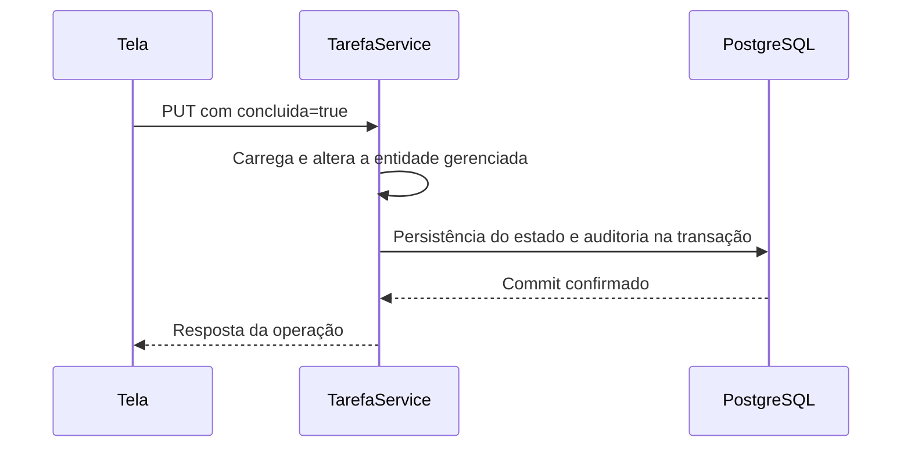

# 03 — Transações e revisões

**Prioridade:** essencial. **Pergunta:** cada edição gera uma revisão independente?

## Comece pela unidade de trabalho

Na tela atual, criar, editar e excluir fazem requisições separadas. Cada escrita entra em um método transacional de [TarefaService](../../../src/main/java/br/com/laboratorio/todo/tarefa/TarefaService.java). Por isso, normalmente observamos uma revisão por ação que efetivamente muda dados auditados.

Mas a unidade que explica a revisão é a **transação**, e não o clique. O [teste de duas tarefas](../../../src/test/java/br/com/laboratorio/todo/AuditoriaIntegrationTest.java) envolve duas chamadas do serviço em um `TransactionTemplate` externo. Elas participam da mesma transação e a última revisão de cada tarefa tem o mesmo número.

| Cenário no laboratório | Resultado coberto por teste existente |
|---|---|
| Criar e editar em operações separadas | Revisões diferentes |
| Alterar duas tarefas em uma transação | Número de revisão compartilhado |
| Gravar tarefa e realizar rollback | Sem tarefa nem histórico persistido |
| Enviar atualização sem mudar valores | Sem revisão adicional |

## O que acontece ao concluir uma tarefa



Este é um desenho conceitual da transação, não um registro da ordem exata de todos os comandos SQL. `saveAndFlush` pode enviar comandos antes do commit; o teste de rollback demonstra que isso não torna a gravação definitiva.

## Experimento pela tela

1. Crie uma tarefa e anote quantas revisões ela possui.
2. Abra “Editar” e salve sem mudar nada.
3. Confira a contagem.
4. Agora mude `concluida` e salve.
5. Confira novamente.

```sql
SELECT a.id, a.rev, a.revtype, r.autor
FROM tarefa_aud a JOIN revisao r ON r.id = a.rev
WHERE a.id = :id_tarefa ORDER BY a.rev;
```

**Resultado esperado:** o envio sem mudança mantém a contagem; a conclusão acrescenta uma revisão. Não extrapole o exemplo para transações complexas com alterações e reversões intermediárias: esse comportamento precisa de teste próprio.

## Experimento com testes existentes

Na raiz do projeto, com Docker disponível:

```bash
mvn -Dapi.version=1.44 '-Dtest=AuditoriaIntegrationTest#duasTarefasAlteradasNaMesmaTransacaoCompartilhamRevisao+rollbackNaoPersisteTarefaNemHistorico+atualizacaoSemMudancaNaoCriaNovaRevisao' test
```

O parâmetro de API Docker é o ajuste usado na validação inicial deste ambiente; pode ser dispensável em outros ambientes. O Testcontainers utiliza um PostgreSQL temporário. A tela não oferece botões para rollback ou atualização conjunta de duas tarefas; esses cenários são demonstrados pelo teste.

## Exclusão e numeração

A API preserva o conteúdo na revisão de exclusão por `store_data_at_delete=true`. Isso não mantém a tarefa na tabela atual. O número da revisão também não é um contador particular da tarefa: outras alterações auditadas podem ocupar números intermediários. Não use diferenças entre números para contar edições.

## Explique com suas palavras

“Se a tarefa A tem revisões 10 e 15, ela sofreu cinco alterações? E duas tarefas podem ter a revisão 15?”

Os números são ilustrativos. Explique a resposta a partir do limite da transação e do caráter compartilhado da revisão.

## Referência oficial

- [Revision Log](https://docs.hibernate.org/orm/6.6/userguide/html_single/#envers-revisionlog).
- [Understanding the Envers Schema](https://docs.hibernate.org/orm/6.6/userguide/html_single/#envers-schema).
- [Configuração de exclusão](https://docs.hibernate.org/orm/6.6/userguide/html_single/#envers-configuration).

[Anterior](../02-mapeamento-e-tabelas/README.md) · [Índice](../README.md) · [Próximo: consultas](../04-consulta-do-historico/README.md)
