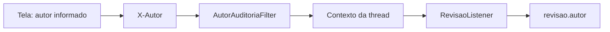

# 05 — Autoria e metadados da revisão

**Prioridade:** essencial. **Pergunta:** o Envers sabe quem é o usuário?

## A informação tem uma origem

Neste laboratório, o texto digitado em “Autor do experimento” chega ao servidor no cabeçalho `X-Autor`. O Envers não autentica esse nome. É a aplicação que fornece o valor ao criar os metadados da revisão.



## Onde cada responsabilidade está

| Código | Papel no ToDo |
|---|---|
| [AutorAuditoriaFilter](../../../src/main/java/br/com/laboratorio/todo/audit/AutorAuditoriaFilter.java) | Valida formato do cabeçalho e define o contexto |
| [AutorAuditoria](../../../src/main/java/br/com/laboratorio/todo/audit/AutorAuditoria.java) | Guarda temporariamente o autor em `ThreadLocal` |
| [RevisaoListener](../../../src/main/java/br/com/laboratorio/todo/audit/RevisaoListener.java) | Copia o autor atual para a entidade de revisão |
| [Revisao](../../../src/main/java/br/com/laboratorio/todo/audit/Revisao.java) | Mapeia `id`, `instante` e `autor` no banco |

O filtro usa `finally` para remover o contexto após a requisição. Não trate esse `ThreadLocal` como transporte automático de identidade entre tarefas assíncronas ou outras threads; essa extensão precisaria de uma solução própria e testes.

## O que a revisão contém

```java
// Trecho da entidade Revisao atual.
@RevisionTimestamp
@Column(nullable = false)
private long instante;

@Column(nullable = false, length = 100)
private String autor;
```

O `id` é anotado com `@RevisionNumber`; `@RevisionEntity(RevisaoListener.class)` liga entidade e listener. O instante é armazenado em milissegundos e convertido pelo serviço para `Instant`.

No desenho atual, a autoria pertence à revisão. As duas tarefas alteradas em uma única transação compartilham esses metadados. Não existe um autor independente para cada linha dentro da mesma revisão.

## Experimento implementado

1. Com autor `Ana`, crie uma tarefa nova.
2. Troque o autor para `Bruno` e altere o título.
3. Consulte o histórico.

```sql
SELECT a.id, a.rev, r.autor,
       to_timestamp(r.instante / 1000.0) AS instante_revisao
FROM tarefa_aud a JOIN revisao r ON r.id = a.rev
WHERE a.id = :id_tarefa ORDER BY a.rev;
```

**Resultado esperado:** criação atribuída ao texto `Ana` e alteração a `Bruno`. A exibição do horário pode variar conforme o fuso da sessão SQL ou do navegador; isso não muda o instante armazenado. O timestamp da revisão não deve ser apresentado como medição exata do horário de commit do PostgreSQL.

**Teste existente:** `crudHttpRegistraAutorCamposEExclusaoComSnapshot` verifica autores diferentes e a limpeza do contexto. Sem cabeçalho, o filtro define `anonimo-laboratorio`; fora desse contexto, o utilitário retorna `sistema`.

## Experimento proposto: identidade autenticada

Em uma futura integração de login, substitua a origem do valor por um identificador estável do usuário autenticado. Defina também como identificar execução automática, ação delegada e ausência de identidade. Se houver tenant ou identificador de correlação, decida explicitamente se pertencem aos metadados.

Ainda não há Spring Security nem validação de identidade no laboratório. Validar tamanho do cabeçalho não comprova a identidade do autor.

## Explique com suas palavras

“Se alguém enviar `X-Autor: Diretor`, o banco provará que o diretor realizou a alteração?”

Sua explicação deve identificar a origem do valor e o que falta para torná-la confiável.

## Referência oficial

- [Revision Log e entidade personalizada](https://docs.hibernate.org/orm/6.6/userguide/html_single/#envers-revisionlog).

[Anterior](../04-consulta-do-historico/README.md) · [Índice](../README.md) · [Próximo: limites](../06-limites-e-cuidados/README.md)
