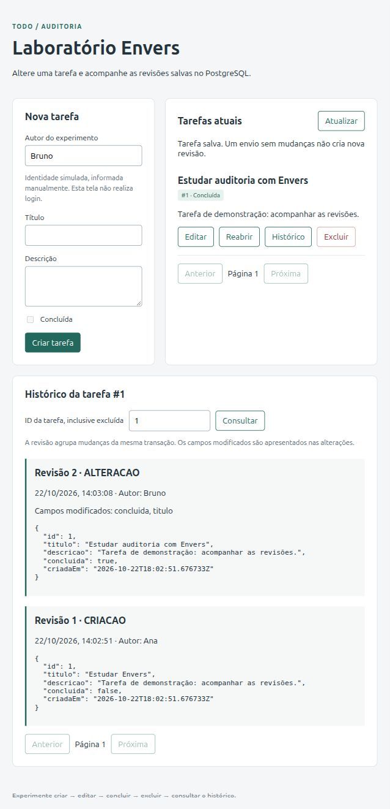

# Validação inicial — 22/10/2026

## Execução confirmada

- `mvn -B -Dapi.version=1.44 test`: **8 testes executados, 0 falhas, 0 erros, 0 ignorados**.
- Banco dos testes: PostgreSQL 16 temporário, criado pelo Testcontainers.
- Migração Flyway aplicada e esquema validado pelo Hibernate.
- API local iniciada em `http://localhost:8080`, conectada ao PostgreSQL do Compose na porta 5433.
- JavaScript validado sintaticamente com `node --check`.

## Verificação na interface

Foi criada a tarefa #1 “Estudar Envers” com autor simulado `Ana`. Pela tela, o autor foi alterado para `Bruno`, o título foi editado para “Estudar auditoria com Envers” e a tarefa foi marcada como concluída.

A tela exibiu duas revisões e indicou `concluida` e `titulo` como campos modificados na segunda revisão. Uma consulta SQL ao PostgreSQL confirmou:

| Tarefa | Revisão | Tipo | Autor | Título | Concluída |
|---|---|---|---|---|---|
| 1 | 1 | 0 — criação | Ana | Estudar Envers | false |
| 1 | 2 | 1 — alteração | Bruno | Estudar auditoria com Envers | true |

A tarefa de demonstração foi preservada no banco local para exploração. Os testes automatizados usaram outro banco temporário.

## Limites desta validação

Exclusão com preservação do histórico, rollback, transação compartilhada, ausência de mudança e SQL direto foram verificados pelos testes automatizados. A verificação manual na tela cobriu criação, edição, conclusão e exibição do histórico. Não foram realizados testes de carga, avaliação de capacidade, login real ou os experimentos avançados previstos no roteiro.
